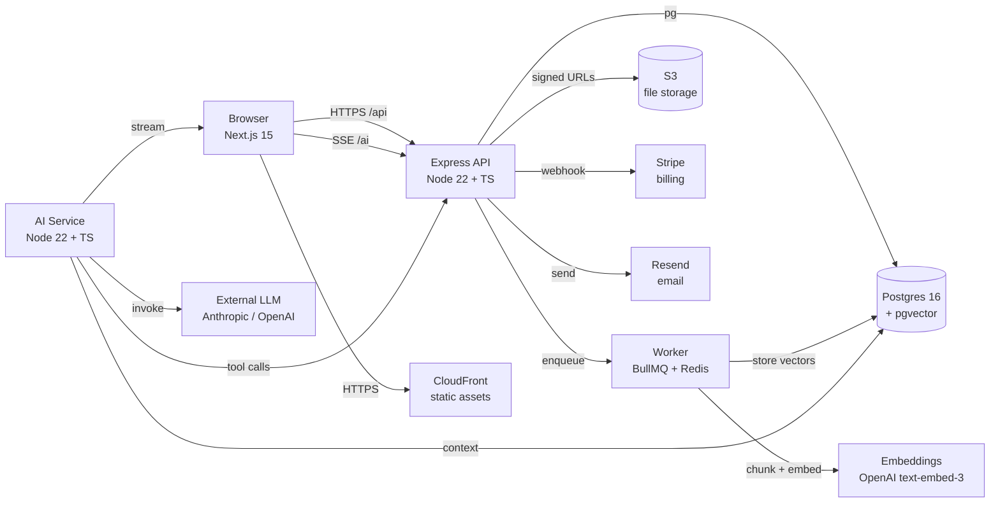

# Capstone — Multi-Tenant AI SaaS

> The final, integrative project for the entire course. 4 weeks part-time, 2 weeks full-time equivalent. The artifact you ship into the world.

---

## Project overview

You are going to take the **multi-tenant SaaS** from Mission 4 and turn it into an **AI-native product**. Same foundation — auth, workspaces, projects, files, RBAC, billing — but now every workspace gets an AI assistant, every uploaded PDF becomes a queryable knowledge base, and there's an AI PM that can read the project, summarize activity, and create tasks on your behalf.

This is not "add a chat box to a SaaS." This is "ship a product that would not have been possible 5 years ago, in 4 weeks, because the AI is now good enough to be the differentiator."

The capstone proves you can:

1. Design and ship a multi-tenant product.
2. Integrate a frontier LLM safely and observably.
3. Build RAG that doesn't lie.
4. Ship an agent that does real work.
5. Deploy, monitor, and demo the result.

---

## Architecture



**Three processes, not one.** The API, the AI service, and the worker are separate. They scale independently, fail independently, and reason independently. This is the production pattern; a single Express process doing everything is what you built in Mission 4, and it's fine for that.

---

## Feature checklist (the must-haves)

### 1. Multi-tenant authentication & RBAC (from Mission 4)

- Email + password registration, JWT login.
- Refresh token rotation.
- Roles: `OWNER`, `ADMIN`, `MEMBER`, `BILLING`.
- Per-workspace isolation: every query is scoped by `workspaceId` from the JWT.
- **Done when:** two users in the same workspace can see each other's projects; a user in workspace A cannot list projects in workspace B, even with a guessed ID.

### 2. Workspace, team & project management (from Mission 4)

- Create workspace, invite members by email, accept invite, role assignment.
- Projects inside a workspace, with members and status.
- Audit log: every state change is recorded with actor, action, before, after, timestamp.
- **Done when:** an admin can invite, demote, and remove a member; every action is in the audit log.

### 3. File management (from Mission 4)

- Upload to S3 via signed URLs (the browser uploads directly; the API never sees the bytes).
- File metadata in Postgres, scoped by workspace.
- Download via short-lived signed URL.
- **Done when:** a 50MB PDF uploads, downloads, and the URL expires in 15 minutes.

### 4. AI chat interface for each workspace

- Streaming chat UI (Server-Sent Events or WebSockets).
- The chat has access to: the current project, the user's recent files, the workspace's members.
- Citations: when the model uses a file as context, show it.
- Token + cost counter on every message.
- **Done when:** I can ask "what is this project about?" and get a real, cited answer in under 3 seconds.

### 5. RAG over user-uploaded PDFs ("ask your docs")

- On upload: extract text, chunk (RecursiveCharacterTextSplitter, 1000/200), embed (`text-embedding-3-small`), store in `pgvector`.
- On query: embed the question, cosine-similarity top-k=8, rerank, send to the LLM with the chunks as context.
- Stream the response with inline citations (`[1]`, `[2]`) that link to the source PDF page.
- **Done when:** I can upload a 30-page contract and ask "what's the termination clause?" and get a correct, cited answer.

### 6. AI agent that can create tasks, search projects, summarize activity ("AI PM")

- The agent has tools: `search_projects`, `create_task`, `list_recent_activity`, `summarize_project`, `assign_task`.
- Tool calls go through the same RBAC as a real user. The agent *is* a user — a special service account in the workspace.
- Every tool call is logged with the model's reasoning trace (for debugging) and the user that triggered the agent.
- A "Stop" button that cancels the run.
- **Done when:** I can say "summarize what happened in the Acme project this week" and the agent calls `list_recent_activity` + `summarize_project` and returns a 3-bullet answer.

### 7. Per-workspace usage tracking and quotas

- Every LLM call records: `workspaceId`, `userId`, `model`, `inputTokens`, `outputTokens`, `costUsd`, `latencyMs`.
- A nightly job rolls up usage per workspace.
- A quota check on every request: if `usage.month > plan.limit`, return 402 with a Stripe upgrade link.
- **Done when:** the FREE plan is capped at 100k tokens/month, and the 101st request returns a clear "you've hit your limit, upgrade here" message.

### 8. Analytics dashboard (engagement, AI usage, cost)

- For the workspace owner: daily active users, projects created, files uploaded, AI messages sent, total AI cost.
- For the admin (you): global view across workspaces.
- Charts: 7-day and 30-day windows. Drill-down from a chart to the raw events.
- **Done when:** I can see, on one screen, "this workspace cost $14 last month, sent 2,300 AI messages, 87% of which used RAG."

### 9. Containerized, deployed on a VPS with NGINX + CI/CD

- `docker-compose.yml` for local development.
- Production: one VPS (Hetzner or AWS Lightsail, ~$5–20/month) running 3 containers (api, ai, worker) + Postgres + Redis + NGINX.
- CI: GitHub Actions. On PR: test, lint, typecheck. On merge: build, push, deploy via SSH.
- TLS via Let's Encrypt. DNS via Cloudflare or Route 53.
- **Done when:** `git push` to `main` results in a deployed, healthy production in under 5 minutes.

### 10. Public, deployed link + a 5-minute Loom walkthrough

- A real URL, with a real domain, on HTTPS.
- A 5-minute Loom walking through: signup, create a workspace, upload a PDF, ask a question, ask the AI PM to summarize. No edits, no cuts.
- The Loom is the demo. The deployed app is the proof. Both are required.

---

## Deliverables

| # | Deliverable | Format |
|---|---|---|
| 1 | Source code | Public GitHub repo, with a complete README |
| 2 | Live deployment | A real URL, on HTTPS, with a real domain |
| 3 | Loom walkthrough | 5 minutes, no edits, walking through the features |
| 4 | README | Setup, architecture, env vars, deploy steps, screenshots |
| 5 | Postmortem | 1 page: "What broke, what I fixed, what I'd do differently" |
| 6 | Cost report | "I spent $X on LLMs, $Y on infra, $Z on the domain" |
| 7 | Spec artifact | The 1–2 page spec for one of the AI features (from the masterclass) |

---

## Evaluation criteria

| Category | Weight | What we're looking for |
|---|---|---|
| **Functional** | 30% | All 10 features work. The 5-min Loom is uninterrupted. |
| **Code quality** | 20% | Modular, typed, tested. No copy-paste. No `any` in the AI service. |
| **Deployment** | 15% | Real URL, real domain, CI on green, smoke test passing. |
| **Demo** | 15% | The Loom is clear, the features are explained, the AI doesn't embarrass you. |
| **AI features** | 20% | RAG is real (cited, correct). The agent actually does work. Quotas hold. |

### What "good" looks like

- The README has an architecture diagram (the Mermaid one above, yours may differ).
- The tests pass on CI on the first push.
- The postmortem is honest ("I burned $40 on LLM calls in a single debug session because I had no caching" is a *good* postmortem).
- The Loom is 5 minutes, not 25.
- The spec artifact is a real spec, not a one-liner.

### What "great" looks like

- Multi-modal: an AI feature that takes an image as input.
- A custom MCP server the AI uses.
- An AI feature you can demo in 30 seconds.
- A cost-saving insight in the postmortem (e.g., "I cut LLM cost 60% by adding a prompt cache for the system prompt").

---

## Timeline

### 4 weeks part-time (15–20 hours/week)

| Week | Focus | Done when |
|---|---|---|
| 1 | Refactor Mission 4 into the new architecture. Stand up the deployment. | Deployed "hello world" with auth and a workspace |
| 2 | Build the AI chat + RAG. Upload a PDF, ask a question, get a cited answer. | RAG works end-to-end on a real PDF |
| 3 | Build the AI agent. Add the usage/quota system. | The AI PM can create a task; quotas hold |
| 4 | Analytics dashboard, polish, Loom, postmortem. | Submitted, all 7 deliverables in |

### 2 weeks full-time (intensive)

| Days | Focus |
|---|---|
| 1–2 | Refactor + deploy |
| 3–5 | AI chat + RAG |
| 6–7 | AI agent + quotas |
| 8 | Analytics + dashboard |
| 9 | Polish, CI, smoke tests |
| 10 | Loom, postmortem, submit |

---

## Stretch features (the "great" tier)

Pick **at most two**. Shipping the must-haves well is more impressive than shipping everything poorly.

### Multi-modal inputs

The AI can take an image as input. "Look at this mockup and tell me what to build." Uses the multimodal capability of Claude Sonnet 4.5 / GPT-5.

**Effort:** 1–2 days.

### Voice

Speech-to-text input (Whisper API), text-to-speech output (ElevenLabs). "Talk to your projects."

**Effort:** 2–3 days.

### AI-powered onboarding

When a new workspace is created, an AI agent reads the workspace name, asks 3 clarifying questions, and seeds it with suggested projects, members, and a first task.

**Effort:** 2–3 days.

### Marketplace of AI agents

Users can install pre-built agents (e.g., "Standup Bot" that posts a daily summary, "Code Reviewer" that reads PRs) into their workspace.

**Effort:** 5–7 days. This is the closest to a "real" startup feature.

### Realtime collaboration

Multiple users editing the same project with CRDTs (Yjs) and an AI sidebar that sees the same state.

**Effort:** 1+ week. Big lift, big payoff.

### Per-tenant fine-tuning

Let workspace owners fine-tune a small model on their own data for a specific task. LoRA on Llama 3.2 8B, hosted on a GPU instance (RunPod, Modal).

**Effort:** 1+ week. Hard. Don't do this unless you're curious about ML.

---

## The spec artifact (one of the deliverables)

Per the Agentic AI Masterclass (sessions 5 + 9), the spec for *one* of the AI features must be in the repo. Use this template:

```markdown
# Feature: <name>

## Goal
One sentence.

## Non-goals
- ...

## User story
As a <role>, I want to <do>, so that <why>.

## API contract
POST /api/...
Request: ...
Response: ...
Errors: ...

## Data model
New tables / columns: ...

## Edge cases
- What if the file is empty?
- What if the user is on the FREE plan?
- ...

## Acceptance criteria
- [ ] User can do X
- [ ] AI responds in <3s
- [ ] Citations are shown
- [ ] Cost is recorded
- [ ] Quota is enforced

## Out of scope
- Authentication of the AI agent
- Multi-modal inputs
- ...

## Open questions
- Should the agent be allowed to create tasks without confirmation?
```

A good spec is 1–2 pages. A great spec is 3 pages. A bad spec is 6 lines and missing acceptance criteria.

---

## Cost reality check

For a 2-week intensive, expect:

| Item | Estimated cost |
|---|---|
| LLM API calls (development) | $30–$80 |
| LLM API calls (your demo) | $1–$5 |
| VPS (Hetzner or Lightsail) | $5–$20 |
| Domain | $10–$15/year |
| Postgres (managed, optional) | $0–$15 |
| S3 / CloudFront | $0–$2 |
| Email (Resend) | $0 (free tier) |
| **Total** | **$50–$130** |

Add usage monitoring and a hard daily cap. Set the cap in the LLM provider's dashboard. Do not learn this lesson by accident.

---

## Common pitfalls

1. **Trying to do everything.** Ship the 10 must-haves before any stretch.
2. **No spec for the AI features.** "Add a chat box" is not a spec. Use the template.
3. **RAG without citations.** The model will hallucinate. Citations + a "I don't know" fallback are required.
4. **No quota.** One misconfigured user will burn your LLM budget in an afternoon.
5. **AI agent without RBAC.** If the agent is "above" the user's permissions, you've shipped a privilege-escalation bug.
6. **No observability on the AI.** You need to see every prompt, every token, every tool call. If you can't, you'll spend hours debugging "why did it say that."
7. **Pasting production data into the prompt.** PII leaks. Strip it, hash it, or use the API's data-residency controls.
8. **"I'll deploy it later."** Deploy on day 3. The deploy feedback loop is the best bug-finder.
9. **Demo with cold caches.** Warm the cache before the Loom. Have a backup video.
10. **The Loom is 30 minutes.** Trim it. The hard cap is 5.

---

## After the capstone

Once you submit, you have several options:

1. **Keep building.** Many capstone projects become real products, real companies, real revenue.
2. **Open-source it.** Put the code on GitHub, write a good README, share on Hacker News.
3. **Add it to your portfolio.** The deployed URL, the Loom, the postmortem — those go on your resume and LinkedIn.
4. **Apply for jobs.** You now have a multi-tenant AI SaaS in production, with a real domain, a real CI/CD pipeline, and a real demo. That is the strongest project you can show in 2026.

---

## AI Industry Note (2026)

In 2026, the hiring manager looking at your capstone is asking five questions:

1. **Can you ship?** — A deployed URL with a real domain answers this.
2. **Can you ship *with AI*?** — The RAG, the agent, the streaming chat answer this.
3. **Do you know what you don't know?** — The postmortem answers this.
4. **Can you write a spec?** — The spec artifact answers this.
5. **Do you understand the cost?** — The cost report answers this.

The capstone that hits all five is the capstone that gets interviews. The one that hits three is the one that gets a polite email. The one that hits one is the one that gets a form rejection.

This is the project where everything you learned in 6 missions + 4 reward courses + 1 masterclass comes together. The architect, the backend engineer, the database designer, the devops engineer, the AI engineer, the QA engineer, the PM, the demo-er — all of those are you. That's what a senior engineer looks like. Welcome.

---

*Good luck. Ship it. Show up at the demo. Tell us what broke.*
