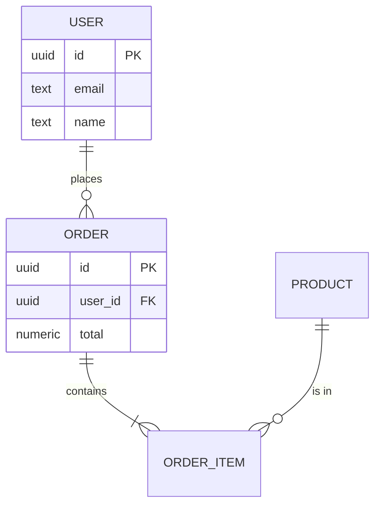

# Module 11 — Database Essentials & Relational Model

> Before you write a single SQL query, you need to think like a database.

---

## Why this module matters

Most TypeScript developers can write a CRUD endpoint. Far fewer can sit down with a written brief and produce a *correct* relational schema that survives 18 months of feature requests. This module and the next five teach that skill.

We will work through the entire pipeline:

**Brief → ER Diagram → Normalized schema → Postgres DDL → Seed data → Real queries**

By the end of Mission 3 you will have done this end to end with a multi-tenant SaaS-style brief, ready to be the foundation of your Mission 4 capstone.

---

## Learning objectives

- Distinguish data, information, and database.
- Explain what a DBMS is and why we use one.
- Identify the parts of the relational model.
- Define keys (super, candidate, primary, alternate, composite).
- Use foreign keys to model relationships.
- Apply the top-down database design technique.
- Read and draw ER diagrams.
- Understand cardinality and relationship types.

---

## 1. Data, information, and database

- **Data** — raw facts: `42`, `"Rumi"`, `2026-01-15`.
- **Information** — data in a useful context: *"Rumi is 42, joined on Jan 15, 2026."*
- **Database** — an organized collection of related data, persisted, queryable, and protected by a DBMS.

The DBMS (Database Management System) — PostgreSQL, MySQL, Oracle — is the software that *manages* the database: stores, retrieves, secures, transactions, concurrency.

---

## 2. The relational model

A **relation** is a table with:

- A name (e.g. `users`).
- A **schema** — the column definitions.
- A set of **tuples** (rows) — each with the same attributes.

The relational model was invented by **Edgar F. Codd** in 1970. The key insights:

- Data is organized in **tables** (relations), not files or hierarchies.
- Each table has a **primary key** that uniquely identifies a row.
- Tables are **related** via **foreign keys**.
- You query data with **declarative** languages (SQL), not procedural.

---

## 3. Keys — the vocabulary

| Term | Definition |
|------|------------|
| **Super key** | Any set of columns that uniquely identifies a row |
| **Candidate key** | A *minimal* super key — no subset is also a super key |
| **Primary key** | The candidate key you choose to identify rows |
| **Alternate key** | Candidate keys that were not chosen |
| **Composite key** | A key with more than one column |
| **Foreign key** | A column whose values reference the primary key of another table |

```sql
CREATE TABLE users (
  id          UUID PRIMARY KEY DEFAULT gen_random_uuid(),   -- primary key
  email       TEXT NOT NULL UNIQUE,                          -- alternate (unique) key
  name        TEXT NOT NULL
);

CREATE TABLE orders (
  id          UUID PRIMARY KEY DEFAULT gen_random_uuid(),
  user_id     UUID NOT NULL REFERENCES users(id),            -- foreign key
  total       NUMERIC(10,2) NOT NULL
);
```

**Rule of thumb:** use a synthetic `UUID` or `BIGSERIAL` as the primary key. Use natural keys (email, ISBN) as *unique* constraints, not primary keys — natural keys can change.

---

## 4. Foreign keys — modeling relationships

A foreign key **enforces referential integrity**: a row cannot reference a row that doesn't exist.

```sql
CREATE TABLE comments (
  id         UUID PRIMARY KEY DEFAULT gen_random_uuid(),
  post_id    UUID NOT NULL REFERENCES posts(id) ON DELETE CASCADE,
  author_id  UUID NOT NULL REFERENCES users(id) ON DELETE RESTRICT,
  body       TEXT NOT NULL
);
```

### ON DELETE options

| Option | What happens when the parent is deleted |
|--------|----------------------------------------|
| `CASCADE` | Child rows are deleted too |
| `RESTRICT` | Deletion is blocked if children exist (default) |
| `SET NULL` | Child's FK becomes `NULL` |
| `NO ACTION` | Like RESTRICT but checked at end of statement |

**Choose deliberately.** Deleting a workspace should cascade to projects but probably not to audit logs.

---

## 5. Top-down database design

The technique:

1. **Read the brief.** Identify the noun-phrases (entities) and verb-phrases (relationships).
2. **Draw an ER diagram** — entities as rectangles, relationships as diamonds.
3. **Add attributes** — fields each entity needs.
4. **Identify primary keys** for each entity.
5. **Identify relationships and cardinalities** (1:1, 1:N, M:N).
6. **Apply normalization rules** (Module 12) to reduce redundancy.
7. **Translate to SQL DDL.**
8. **Seed with sample data.**
9. **Write the queries the application needs.**

---

## 6. The ER diagram

```
   ┌──────────────┐         ┌──────────────┐
   │    users     │ 1     N │    orders    │
   │──────────────│─────────│──────────────│
   │ id (PK)      │         │ id (PK)      │
   │ email        │         │ user_id (FK) │
   │ name         │         │ total        │
   │ created_at   │         │ created_at   │
   └──────────────┘         └──────────────┘

   ┌──────────────┐         ┌──────────────┐
   │    orders    │ 1     N │ order_items  │ N     1 ┌──────────────┐
   │──────────────│─────────│──────────────│─────────│   products   │
   │ id (PK)      │         │ id (PK)      │         │──────────────│
   │ user_id (FK) │         │ order_id (FK)│         │ id (PK)      │
   │              │         │ product_id   │────────►│ name         │
   │              │         │ quantity     │         │ price        │
   │              │         │ unit_price   │         └──────────────┘
   └──────────────┘         └──────────────┘
```

Tools: [dbdiagram.io](https://dbdiagram.io/), [draw.io](https://app.diagrams.net/), [Mermaid](https://mermaid.js.org/) (in Markdown), or pen + paper.

A Mermaid example:



---

## 7. Cardinality and relationship types

### Cardinality

- **One-to-One (1:1)** — `user` has one `profile`.
- **One-to-Many (1:N)** — `user` has many `orders`.
- **Many-to-Many (M:N)** — `student` takes many `courses`, and `course` has many `students` (modeled via a junction table).

### Participation (optionality)

- **Total** — every entity *must* participate (e.g. every order has a customer).
- **Partial** — participation is optional (e.g. a user may have zero orders).

These two axes combine:

```
User 1 ── (0,N) Order    "a user may have zero or many orders"
User 1 ── (1,1) Profile  "every user has exactly one profile"
User N ── (0,N) Course   "a student may take zero or many courses"
```

---

## 8. The brief → entities exercise (you will do this for real in Mission 4)

Read this brief:

> "A small startup needs a SaaS where users can create workspaces, invite teammates, create projects inside workspaces, and add tasks with assignees, due dates, comments, and file attachments. Workspaces have billing plans. Each user has one personal profile."

### Entities you should find

- `User`
- `Workspace`
- `Membership` (the M:N between users and workspaces, with role)
- `Project` (belongs to a workspace)
- `Task` (belongs to a project, has an assignee)
- `Comment` (belongs to a task, by a user)
- `Attachment` (belongs to a task, has a file URL)
- `Plan` (the billing plan)
- `Subscription` (workspace ↔ plan)

### Relationships

- `User` M:N `Workspace` via `Membership`
- `Workspace` 1:N `Project`
- `Project` 1:N `Task`
- `Task` N:1 `User` (assignee)
- `Task` 1:N `Comment`
- `Task` 1:N `Attachment`
- `Workspace` 1:1 `Subscription`
- `Subscription` N:1 `Plan`

Draw it. Add cardinalities. Then proceed to Module 12 to normalize it.

---

## 9. Common mistakes

1. **Storing a list in one column.** Never `tags TEXT` with comma-separated values. Use a junction table.
2. **Using a natural key as the primary key** that later needs to change (email, name).
3. **Forgetting `ON DELETE` behavior** — leaves orphaned rows or blocks legitimate deletes.
4. **Confusing 1:1 with 1:N** — usually because the brief is ambiguous. Ask.
5. **No timestamps.** Every table gets `created_at` and (usually) `updated_at` in 2026.

---

## Exercise

1. Read a brief of your own (a course-management system, a fitness tracker, a recipe app) and list the entities.
2. Draw an ER diagram in Mermaid inside a `README.md`.
3. For each entity, identify the primary key and the unique constraints.
4. For each relationship, identify the cardinality and participation.
5. Identify which relationships are M:N and which will require junction tables.
6. Translate the ER diagram into `CREATE TABLE` statements (no data yet, just schema).

---

## AI Industry Note (2026)

- **ER diagrams are the first artifact AI assistants get wrong.** Ask Claude or GPT-4o to "design a database for X" and you'll see them flatten M:N into JSON columns, forget `ON DELETE`, and skip `created_at`. **You are the one who enforces the relational discipline.** Use the AI to draft, you to verify against the rules in this module.
- **Schema design is also a prompt-engineering skill.** A schema is a *contract* between your code and your data. Once 10 endpoints depend on `tasks.assignee_id`, you cannot rename it without a migration. The senior move is to **spend more time on the schema than on the code**. AI can write the code 10x faster; it cannot undo a bad schema.
- **What to read next:** Codd's original 1970 paper, *"A Relational Model of Data for Large Shared Data Banks."* It's 8 pages and you can read it in 30 minutes. The vocabulary in this module comes directly from it.
