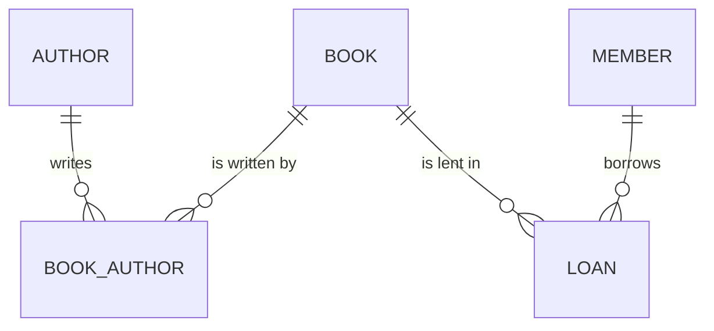

# Module 13 — PostgreSQL Essentials: Case Study, Data Types & Constraints

> Where we leave psql-as-a-toy and start using Postgres as a real application database.

---

## Why this module matters

You have a normalized schema in your head. Now you need to be able to *type it into psql*, *explore an existing database*, and *be confident that the types and constraints actually protect your data*.

This module walks through the canonical "library / books / authors" case study, then drills into every data type and constraint you will use in Mission 4.

---

## Learning objectives

- Solve the canonical case study from requirement to schema.
- Create, connect to, and drop databases in Postgres.
- Manage users, roles, and privileges.
- Use every common data type with confidence.
- Apply column constraints to enforce invariants.
- Insert data and verify constraint behavior.

---

## 1. The case study

> "Build a small library system. We track books, the authors who wrote them, the members who borrow them, and the loans themselves. A book can have multiple authors, and a member can have multiple active loans. Each book has an ISBN."

### The 3NF schema

```
authors(id, name, bio, created_at)
books(id, title, isbn UNIQUE, published_year, created_at)
book_authors(book_id, author_id)            -- junction, M:N
members(id, name, email UNIQUE, joined_at)
loans(id, book_id, member_id, loaned_at, due_at, returned_at)
```

### Mermaid ER



---

## 2. Users, roles, and privileges (just enough)

Postgres uses **roles** for both users and groups.

```sql
-- Create a role for the app
CREATE ROLE app LOGIN PASSWORD 'change-me';

-- Create the database owned by the role
CREATE DATABASE library OWNER app;

-- Grant the minimum needed
GRANT CONNECT ON DATABASE library TO app;
GRANT USAGE   ON SCHEMA public TO app;
GRANT CREATE  ON SCHEMA public TO app;
```

**Never use the `postgres` superuser from your application.** Create a least-privileged role.

---

## 3. Creating and connecting

```bash
psql -h localhost -U app -d library
```

Inside psql:

```sql
\dt          -- list tables
\d books     -- describe table
\q           -- quit
```

---

## 4. The SQL language — DDL vs DML vs DQL vs DCL

| Category | Commands |
|----------|----------|
| **DDL** (Data Definition) | `CREATE`, `ALTER`, `DROP`, `TRUNCATE` |
| **DML** (Data Manipulation) | `INSERT`, `UPDATE`, `DELETE` |
| **DQL** (Data Query) | `SELECT` |
| **DCL** (Data Control) | `GRANT`, `REVOKE` |
| **TCL** (Transaction Control) | `BEGIN`, `COMMIT`, `ROLLBACK`, `SAVEPOINT` |

---

## 5. Data types — the full toolkit

| Type | Use for | Example |
|------|---------|---------|
| `SMALLINT`, `INT`, `BIGINT` | integers | `42`, `-1` |
| `NUMERIC(p, s)` | exact decimals | `NUMERIC(10,2)` for money |
| `REAL`, `DOUBLE PRECISION` | floating point | ❌ avoid for money |
| `TEXT` | strings (no length limit) | preferred over `VARCHAR` |
| `VARCHAR(n)` | strings with a max | only if you need the constraint |
| `BOOLEAN` | true/false | `true`, `false`, `NULL` |
| `DATE` | date only | `2026-01-15` |
| `TIME` | time only | `14:30:00` |
| `TIMESTAMP` | date + time (no tz) | usually prefer `TIMESTAMPTZ` |
| `TIMESTAMPTZ` | date + time with tz | `2026-01-15 14:30:00+00` |
| `UUID` | unique identifiers | `gen_random_uuid()` |
| `JSONB` | structured JSON, indexable | settings, metadata |
| `JSON` | JSON text, not indexed | rarely used; prefer `JSONB` |
| `BYTEA` | binary data | file blobs (usually store URLs instead) |
| `INET` | IP addresses | `192.168.1.1` |
| `CIDR`, `MACADDR` | network ranges / MACs | networking tools |
| `ARRAY` | arrays of one type | `TEXT[]` for tags (use a junction for M:N) |
| `ENUM` | closed set of strings | `CREATE TYPE status AS ENUM (...)` |

### Money

```sql
amount NUMERIC(10, 2) NOT NULL  -- 8 digits before, 2 after
```

**Never** use `FLOAT` for money. Floating point is an approximation, and 0.1 + 0.2 ≠ 0.3 in IEEE 754. In 2026, several jurisdictions *require* ledger accuracy. Use `NUMERIC` or store as integer cents.

### Timestamps

Always prefer `TIMESTAMPTZ` over `TIMESTAMP`. It stores the instant in UTC; the display layer converts to the user's timezone.

```sql
created_at TIMESTAMPTZ NOT NULL DEFAULT now()
```

### UUIDs

```sql
id UUID PRIMARY KEY DEFAULT gen_random_uuid()
```

Requires `CREATE EXTENSION IF NOT EXISTS pgcrypto` (in PG 12 and below) — PG 13+ has it built in.

### JSONB

```sql
settings JSONB NOT NULL DEFAULT '{}'::jsonb
```

You can index into JSONB:

```sql
CREATE INDEX settings_brand_idx ON users ((settings->>'brand'));
```

---

## 6. Column constraints

| Constraint | Purpose |
|------------|---------|
| `NOT NULL` | required field |
| `UNIQUE` | no duplicates |
| `PRIMARY KEY` | NOT NULL + UNIQUE + indexed |
| `CHECK (expr)` | arbitrary boolean check |
| `REFERENCES ...` | foreign key |
| `DEFAULT value` | auto-fill on insert |

```sql
CREATE TABLE members (
  id          UUID PRIMARY KEY DEFAULT gen_random_uuid(),
  email       TEXT NOT NULL UNIQUE,
  name        TEXT NOT NULL CHECK (length(name) > 0),
  age         INT  CHECK (age >= 0 AND age <= 150),
  status      TEXT NOT NULL DEFAULT 'active' CHECK (status IN ('active','suspended','closed')),
  created_at  TIMESTAMPTZ NOT NULL DEFAULT now()
);
```

**Constraints are your first line of defense against bad data.** Add them in the schema, not in the application.

---

## 7. The `CREATE TABLE` deep-dive

```sql
CREATE TABLE books (
  id              UUID PRIMARY KEY DEFAULT gen_random_uuid(),
  title           TEXT NOT NULL,
  isbn            TEXT NOT NULL UNIQUE,
  published_year  INT  CHECK (published_year BETWEEN 0 AND EXTRACT(YEAR FROM now())::INT),
  total_copies    INT  NOT NULL DEFAULT 1 CHECK (total_copies >= 0),
  created_at      TIMESTAMPTZ NOT NULL DEFAULT now()
);

CREATE TABLE book_authors (
  book_id   UUID NOT NULL REFERENCES books(id)   ON DELETE CASCADE,
  author_id UUID NOT NULL REFERENCES authors(id) ON DELETE CASCADE,
  PRIMARY KEY (book_id, author_id)
);
```

### `SERIAL` vs `IDENTITY` vs `UUID`

```sql
-- Old style
id SERIAL PRIMARY KEY  -- a 4-byte auto-increment int

-- SQL standard
id INT GENERATED ALWAYS AS IDENTITY PRIMARY KEY

-- Modern preferred
id UUID PRIMARY KEY DEFAULT gen_random_uuid()
```

For new code, **default to UUIDs**. They are safe to expose in URLs, can be generated client-side, and don't leak business data (e.g. user count).

---

## 8. Inserting data and checking constraints

```sql
INSERT INTO authors (name) VALUES ('Ursula K. Le Guin');
INSERT INTO books (title, isbn, published_year) VALUES
  ('The Dispossessed', '0061054887', 1974),
  ('A Wizard of Earthsea', '0553262504', 1968);

INSERT INTO book_authors (book_id, author_id)
SELECT b.id, a.id FROM books b, authors a
 WHERE b.title = 'The Dispossessed' AND a.name = 'Ursula K. Le Guin';

INSERT INTO members (email, name) VALUES ('rumi@x.com', 'Rumi');
INSERT INTO loans (book_id, member_id, due_at)
SELECT b.id, m.id, now() + interval '14 days'
  FROM books b, members m
 WHERE b.title = 'A Wizard of Earthsea' AND m.email = 'rumi@x.com';
```

### Constraint behavior

```sql
-- Duplicate email → ERROR: duplicate key value violates unique constraint
INSERT INTO members (email, name) VALUES ('rumi@x.com', 'Other');

-- Negative copies → ERROR: new row for relation "books" violates check constraint
INSERT INTO books (title, isbn, total_copies) VALUES ('x', '000', -1);

-- Orphan FK → ERROR: insert or update on table "book_authors" violates foreign key constraint
INSERT INTO book_authors (book_id, author_id) VALUES ('00000000-0000-0000-0000-000000000000', '00000000-0000-0000-0000-000000000000');
```

These errors are your friend. **They mean the data is being protected.**

---

## 9. `ALTER TABLE` — evolving the schema

```sql
-- Add a column
ALTER TABLE books ADD COLUMN genre TEXT;

-- Add a constraint
ALTER TABLE books ADD CONSTRAINT genre_known CHECK (genre IS NULL OR genre IN ('sci-fi','fantasy','mystery','romance','non-fiction'));

-- Drop a column
ALTER TABLE books DROP COLUMN genre;

-- Rename a column
ALTER TABLE books RENAME COLUMN title TO name;
```

In production, every `ALTER` is wrapped in a transaction and applied via a migration. We'll use Drizzle migrations in Mission 4.

---

## 10. `DROP` and friends

```sql
DROP TABLE loans;                    -- error if foreign keys reference it
DROP TABLE loans CASCADE;            -- drops dependents (be careful!)
DROP TABLE IF EXISTS loans;          -- no error if missing
```

---

## 11. Common mistakes

1. **Using `FLOAT`/`REAL` for money.** Use `NUMERIC` or integer cents.
2. **No `NOT NULL` on required fields.** Postgres defaults to nullable; the schema should declare the truth.
3. **No `CHECK` constraints.** Bad data slips in and the application has to defend at runtime.
4. **`TEXT` everywhere with no length cap.** Use `VARCHAR(n)` or `CHECK (length(...) < N)` for user-facing fields.
5. **Storing multiple values in one column.** Use a junction table.
6. **Using `SERIAL` for externally-visible IDs.** Use `UUID` and avoid the count leak.

---

## Exercise

1. Create a database `library`. Create the four tables above with proper constraints and FKs.
2. Insert 5 authors, 10 books, 5 members, and 8 loans.
3. Try to insert a row that violates each constraint. Read the error.
4. Add a `genre` column to `books` with a `CHECK` constraint.
5. Add an index on `loans.due_at` (you'll use it in Module 16).
6. Write a SQL file `library.sql` containing every command. Run it with `psql -f library.sql`.

---

## AI Industry Note (2026)

- **The most common bug I see in AI-generated SQL is missing constraints.** AI assistants will happily produce a `CREATE TABLE` with nullable everything, no `CHECK`, and a `FLOAT` money column. The fix is to make constraints a *part of your prompt template*: *"Generate Postgres DDL with TIMESTAMPTZ for time, NUMERIC(10,2) for money, NOT NULL on all required fields, CHECK constraints on enums and numeric ranges, and ON DELETE behavior on every foreign key."* That paragraph is worth 10x better output.
- **Constraints are documentation.** A senior engineer reading `members.status CHECK (status IN ('active','suspended','closed'))` instantly knows the domain. The junior reading the same line asks "what statuses are there?" Always prefer constraints over comments for enum-like fields.
- **What to read next:** the [PostgreSQL documentation chapter on data types](https://www.postgresql.org/docs/current/datatype.html) — short, dense, authoritative. The chapter on [constraints](https://www.postgresql.org/docs/current/ddl-constraints.html) is even shorter and full of examples you can copy.
