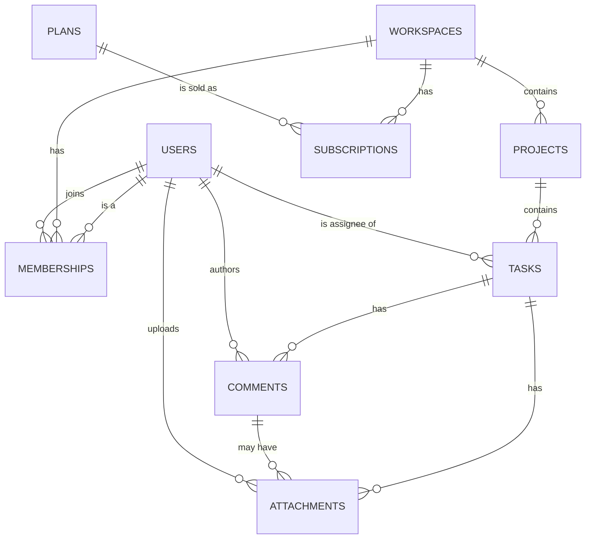

# Module 20 — SaaS System Design & Multi-Tenant Architecture

> Before you write a single line of Drizzle, design the system. Multi-tenancy is the single most consequential decision in a SaaS backend.

---

## Why this module matters

The course SaaS — a multi-tenant project management tool — is the Assignment 4 build. Its requirements come straight from the Mission 3 brief: **multiple users, organized into workspaces, each with projects, tasks, and comments**. The shape is simple. The trap is everything you don't see at first:

- User A from Workspace X must never see user B from Workspace Y.
- A user can belong to multiple workspaces (consultant with two clients).
- Removing someone from a workspace must not delete their identity.
- A `task` row belongs to exactly one workspace, but `task.assignee` may be a user in *that* workspace or somebody who's been removed.
- The system must scale from one workspace to ten thousand **without a rewrite**.

This module is where you make all of those decisions. The Drizzle schema you write next module is the *output* of this design exercise, not the input.

---

## Learning objectives

- Read a product brief and translate it into entities, relationships, and boundaries.
- Explain what "SaaS" means in 2026 and why multi-tenancy is the default architecture.
- Compare the three tenant isolation models and justify choosing **shared schema with `workspace_id`**.
- Design workspaces, memberships, and the tenant-scoping rule.
- Draw a system ERD in Mermaid *before* coding.
- Specify the **tenant context middleware** that injects a workspace into every request.
- Produce the *full* Drizzle schema for the course SaaS (workspaces, memberships, projects, tasks, comments, attachments, plans, subscriptions).
- Recognize the three most common multi-tenant mistakes and prevent them by construction.

---

## 1. The product brief — the course SaaS in plain English

From Mission 3:

> *Teams sign up, create workspaces, invite teammates, organize projects, assign tasks, comment, and attach files. The product is sold per-seat on monthly and annual plans.*

That's it. Now decompose it.

### Actors

- **Visitor** — not logged in. Can sign up or log in.
- **User** — has a global identity (email, name).
- **Workspace member** — a User with a role inside a specific Workspace.
- **Workspace owner** — a special role; the only role that can delete the workspace.
- **Billing admin** — role on a Workspace; can manage payment and seats.
- **Platform admin (Rumi)** — you, the operator. Has back-office access.

### Core entities

| Entity | Description | Notes |
|--------|-------------|-------|
| `User` | The global identity | One user, many workspace memberships |
| `Workspace` | The tenant boundary | All tenant-owned data hangs off this |
| `Membership` | The user-in-workspace join | Holds `role` and `status` |
| `Project` | Container for tasks inside a workspace | |
| `Task` | The atomic unit of work | Assignee, status, priority, due date |
| `Comment` | Threaded discussion on a task | |
| `Attachment` | File pointer on a task or comment | Actual bytes in object storage |
| `Plan` | The catalog row (Free, Pro, Business) | Owned by the platform, not a tenant |
| `Subscription` | A workspace's active plan | Holds Stripe IDs, renewal date |

### Boundary rules

1. A `User` exists *outside* any workspace — they can sign in even if they're not in one.
2. A `Membership` is the only way to cross from global to per-tenant.
3. `Project`, `Task`, `Comment`, `Attachment` are all **tenant-scoped**: every row carries a `workspace_id`.
4. `Plan` rows are **platform-scoped**: every workspace sees the same plans.
5. `Subscription` is per workspace — never per user.

---

## 2. SaaS fundamentals in two minutes

**SaaS** = one codebase, one deployment, many customers (tenants).

The alternative — running a separate stack per customer — is the "on-prem" or "managed single-tenant" model. It is more expensive, slower to ship, but easier to isolate.

### The 3-tier mental model

```
   ┌───────────────────────────────────────────────┐
   │  Presentation   Next.js (App Router, RSC)     │
   │  ─────────────────────────────────────────── │
   │  Application    Express API (Node 22, TS)    │
   │  ─────────────────────────────────────────── │
   │  Persistence    PostgreSQL 16 + Drizzle       │
   └───────────────────────────────────────────────┘
```

The Saas splits the presentation into two surfaces:

- **Marketing site** (`/`, `/pricing`) — public, Next.js, no tenant context.
- **App** (`/app/[workspace]/...`) — authenticated, Next.js, requires `workspace` in URL.

The Express API is **always** authenticated and **always** tenant-scoped.

### B2B vs B2C

| | B2C (consumer) | B2B (the course SaaS) |
|---|---|---|
| Tenants are… | typically individuals | teams / companies |
| Sign-up flow | self-serve, email | self-serve OR sales-assisted |
| Billing | per-account | per-seat |
| Identity | one user = one tenant | many users = one tenant |
| Plan fit | Free / Pro / Enterprise | Starter / Pro / Business |
| Most common isolation | shared schema | shared schema with `workspace_id` |

The course SaaS is **B2B**. The tenant is the workspace, not the user.

### Why multi-tenant

- **Economies of scale** — one database, one deploy, one URL.
- **Operational simplicity** — patching one codebase fixes every tenant.
- **Faster onboarding** — a new workspace is a row in `workspaces`, not a new cluster.
- **Network effect inside the product** — easier cross-workspace features later (e.g. admin templates).

The cost: you **must** enforce tenant isolation in every line of code that touches tenant data.

---

## 3. The three isolation models

| Model | How | Pros | Cons | When |
|-------|-----|------|------|------|
| **DB per tenant** | one Postgres database per workspace | strongest isolation, easy per-tenant backup/restore | expensive at scale, slow migrations, connection explosions | regulated industries (health), enterprise contracts |
| **Schema per tenant** | one Postgres schema per workspace | logical isolation, shared DB | schema-explosion at thousands of tenants, migration ordering is hell | rare — niche compliance use cases |
| **Shared schema, `tenant_id` column** | one schema, every tenant row carries `workspace_id` | cheapest, fastest, easiest to scale | **you must enforce the filter everywhere** | the default; what we use |

### Why we pick shared schema

- Operational cost stays flat as tenants grow.
- A migration applies to every workspace at the same time.
- Indexes stay compact.
- Connection pooling "just works" — one Pool.

The price is **discipline**: a single forgotten `WHERE workspace_id = $1` is a data leak. We mitigate that with the **tenant-scoping rule** and the **tenant context middleware** in section 5.

---

## 4. The tenant-scoping rule

> **Every query on a tenant-owned row MUST filter by `workspace_id` or join through `memberships`.**

This is a *codebase invariant*, enforced at three layers:

1. **API conventions** — every tenant-scoped route resolves `:workspaceId` from the URL, checks the caller's membership, and reuses the verified `workspaceId` for all queries.
2. **Repository signatures** — every method that touches a tenant table takes a `workspaceId` argument. No exceptions.
3. **Tests** — there is a test class "cross-tenant isolation" that, for every repo method, asserts that calling it from workspace A returns zero rows belonging to workspace B.

### Tenant-owned vs platform-owned

| Tenant-owned (must carry `workspace_id`) | Platform-owned (no `workspace_id`) |
|------------------------------------------|--------------------------------------|
| `workspaces`, `memberships`, `projects`, `tasks`, `comments`, `attachments`, `subscriptions` | `users`, `plans` |

`users` is global — a user signs in before they belong to anything. `plans` is the catalog — every workspace reads the same set.

---

## 5. The system architecture

### Component map

```
            ┌───────────────────────────┐
            │      Next.js (App)        │
            │   app/[ws]/projects/...   │
            └─────────────┬─────────────┘
                          │ fetch (JWT cookie)
            ┌─────────────▼─────────────┐
            │       Express API         │
            │   /v1/workspaces/:ws/...  │
            │   ┌─────────────────────┐ │
            │   │ tenant context mw   │ │
            │   └─────────┬───────────┘ │
            │             │             │
            │   ┌─────────▼───────────┐ │
            │   │   repository layer  │ │
            │   └─────────┬───────────┘ │
            └─────────────┼─────────────┘
                          │ Drizzle
            ┌─────────────▼─────────────┐
            │   PostgreSQL 16           │
            │   shared schema, RLS optional │
            └───────────────────────────┘
                          │
                          ▼
                   S3-compatible object store (attachments)
```

### Request flow — "load workspace X's projects"

```
client  →  GET /v1/workspaces/abc/projects
        →  JWT verified (auth middleware)
        →  TenantContext: load membership(userId, abc)
            • 401 if no membership
            • 200 with ctx.workspaceId = abc, ctx.role = "owner"
        →  ProjectsRepository.list(workspaceId = abc)
            • db.select().from(projects).where(eq(projects.workspaceId, abc))
        →  200 { items: [...] }
```

### The tenant context middleware

```ts
// src/middleware/tenantContext.ts
import type { Request, Response, NextFunction } from "express";
import { db } from "../db/client.js";
import { memberships } from "../db/schema/memberships.js";
import { eq, and } from "drizzle-orm";

export type TenantContext = {
  userId:      string;
  workspaceId: string;
  role:        "owner" | "admin" | "member" | "guest";
  membershipId: string;
};

declare global {
  namespace Express {
    interface Request {
      tenant?: TenantContext;
    }
  }
}

export async function tenantContext(req: Request, res: Response, next: NextFunction) {
  // auth middleware has already set req.userId
  const userId = req.userId;
  if (!userId) return res.status(401).json({ error: "unauthenticated" });

  // Resolve workspace from the URL — /v1/workspaces/:wsId/...
  const wsId = req.params.workspaceId ?? req.params.wsId ?? req.params.ws;
  if (!wsId) return res.status(400).json({ error: "workspace required" });

  const [row] = await db.select().from(memberships)
    .where(and(
      eq(memberships.userId,      userId),
      eq(memberships.workspaceId, wsId),
      eq(memberships.status,     "active"),
    ))
    .limit(1);

  if (!row) return res.status(403).json({ error: "not a member of this workspace" });

  req.tenant = {
    userId,
    workspaceId: wsId,
    role:       row.role,
    membershipId: row.id,
  };
  next();
}
```

Once `req.tenant` is set, every repository call is forced to take it:

```ts
// src/modules/projects/projects.routes.ts
import { Router } from "express";
import { projectsRepo } from "./projects.repository.js";
import { requireRole } from "../../middleware/requireRole.js";

export const projectsRouter = Router({ mergeParams: true });

projectsRouter.use(tenantContext);

projectsRouter.get("/", async (req, res) => {
  const items = await projectsRepo.list(req.tenant!);   // ← workspaceId comes from ctx, never the request body
  res.json({ items });
});

projectsRouter.post("/", requireRole(["admin", "owner"]), async (req, res) => {
  const project = await projectsRepo.create(req.tenant!, req.body);
  res.status(201).json(project);
});
```

`req.body` is validated with Zod (`ProjectCreateInput`) and *never* carries a `workspaceId` — the server pins it.

---

## 6. The ERD — drawn before any code

This is the Mermaid that goes in your design doc **before** you open a `.ts` file.



Read this diagram three times. Every box is a table; every connector is a foreign key. The Drizzle schema in section 7 mirrors it 1:1.

### Design notes on the ERD

- `WORKSPACES.owner_id` → `USERS.id` is **not** a direct arrow from `USERS` to `WORKSPACES`. The membership row already records the owner with `role = "owner"`. We keep `owner_id` for fast ownership checks but the membership is the canonical relationship.
- `TASKS.assignee_id` is nullable. A task can exist before being assigned, and a user can be removed from a workspace without deleting their past work.
- `ATTACHMENTS` is polymorphic (belongs to either `tasks` or `comments`). We model that with two nullable FKs plus a `kind` enum, validated at the application layer.

---

## 7. The full Drizzle schema

```ts
// src/db/schema/users.ts
import { pgTable, uuid, text, timestamp, boolean } from "drizzle-orm/pg-core";

export const users = pgTable("users", {
  id:           uuid("id").primaryKey().defaultRandom(),
  email:        text("email").notNull().unique(),
  name:         text("name").notNull(),
  passwordHash: text("password_hash").notNull(),
  isPlatformAdmin: boolean("is_platform_admin").notNull().default(false),
  createdAt:    timestamp("created_at", { withTimezone: true }).notNull().defaultNow(),
  updatedAt:    timestamp("updated_at", { withTimezone: true }).notNull().defaultNow(),
});
export type User    = typeof users.$inferSelect;
export type NewUser = typeof users.$inferInsert;
```

```ts
// src/db/schema/workspaces.ts
import { pgTable, uuid, text, timestamp, index } from "drizzle-orm/pg-core";
import { users } from "./users.js";

export const workspaces = pgTable("workspaces", {
  id:        uuid("id").primaryKey().defaultRandom(),
  name:      text("name").notNull(),
  ownerId:   uuid("owner_id").notNull().references(() => users.id, { onDelete: "restrict" }),
  slug:      text("slug").notNull().unique(),
  createdAt: timestamp("created_at", { withTimezone: true }).notNull().defaultNow(),
  updatedAt: timestamp("updated_at", { withTimezone: true }).notNull().defaultNow(),
}, (t) => ({
  ownerIdx: index("workspaces_owner_idx").on(t.ownerId),
}));
export type Workspace    = typeof workspaces.$inferSelect;
export type NewWorkspace = typeof workspaces.$inferInsert;
```

```ts
// src/db/schema/memberships.ts
import { pgTable, uuid, text, timestamp, pgEnum, uniqueIndex, index } from "drizzle-orm/pg-core";
import { users }       from "./users.js";
import { workspaces }  from "./workspaces.js";

export const role = pgEnum("membership_role", ["owner", "admin", "member", "guest"]);
export const membershipStatus = pgEnum("membership_status", ["active", "invited", "suspended"]);

export const memberships = pgTable("memberships", {
  id:          uuid("id").primaryKey().defaultRandom(),
  userId:      uuid("user_id").notNull().references(() => users.id,      { onDelete: "cascade" }),
  workspaceId: uuid("workspace_id").notNull().references(() => workspaces.id, { onDelete: "cascade" }),
  role:        role("role").notNull().default("member"),
  status:      membershipStatus("status").notNull().default("active"),
  invitedBy:   uuid("invited_by").references(() => users.id),
  joinedAt:    timestamp("joined_at", { withTimezone: true }).notNull().defaultNow(),
}, (t) => ({
  // One active row per (user, workspace)
  userWsUnique: uniqueIndex("memberships_user_ws_unique").on(t.userId, t.workspaceId),
  wsIdx:        index("memberships_workspace_idx").on(t.workspaceId),
  userIdx:      index("memberships_user_idx").on(t.userId),
}));
export type Membership    = typeof memberships.$inferSelect;
export type NewMembership = typeof memberships.$inferInsert;
```

```ts
// src/db/schema/projects.ts
import { pgTable, uuid, text, timestamp, pgEnum, index } from "drizzle-orm/pg-core";
import { workspaces } from "./workspaces.js";
import { users }      from "./users.js";

export const projectStatus = pgEnum("project_status", ["active", "archived", "deleted"]);

export const projects = pgTable("projects", {
  id:          uuid("id").primaryKey().defaultRandom(),
  workspaceId: uuid("workspace_id").notNull().references(() => workspaces.id, { onDelete: "cascade" }),
  name:        text("name").notNull(),
  description: text("description"),
  status:      projectStatus("status").notNull().default("active"),
  createdBy:   uuid("created_by").notNull().references(() => users.id),
  createdAt:   timestamp("created_at", { withTimezone: true }).notNull().defaultNow(),
  updatedAt:   timestamp("updated_at", { withTimezone: true }).notNull().defaultNow(),
}, (t) => ({
  // Every tenant-owned query hits this index first.
  wsIdx: index("projects_workspace_idx").on(t.workspaceId, t.status),
}));
export type Project    = typeof projects.$inferSelect;
export type NewProject = typeof projects.$inferInsert;
```

```ts
// src/db/schema/tasks.ts
import { pgTable, uuid, text, timestamp, date, integer, pgEnum, index } from "drizzle-orm/pg-core";
import { projects } from "./projects.js";
import { users }    from "./users.js";

export const taskStatus   = pgEnum("task_status",   ["open", "in_progress", "in_review", "done", "cancelled"]);
export const taskPriority = pgEnum("task_priority", ["low", "medium", "high", "urgent"]);

export const tasks = pgTable("tasks", {
  id:           uuid("id").primaryKey().defaultRandom(),
  workspaceId:  uuid("workspace_id").notNull().references(() => projects.workspaceId, { onDelete: "cascade" }),
  // ^ Hold on — see the "compromise" note below; we mirror workspaceId for indexing.
  projectId:    uuid("project_id").notNull().references(() => projects.id, { onDelete: "cascade" }),
  title:        text("title").notNull(),
  description:  text("description"),
  status:       taskStatus("status").notNull().default("open"),
  priority:     taskPriority("priority").notNull().default("medium"),
  assigneeId:   uuid("assignee_id").references(() => users.id, { onDelete: "set null" }),
  dueOn:        date("due_on"),
  storyPoints:  integer("story_points"),
  createdBy:    uuid("created_by").notNull().references(() => users.id),
  createdAt:    timestamp("created_at", { withTimezone: true }).notNull().defaultNow(),
  updatedAt:    timestamp("updated_at", { withTimezone: true }).notNull().defaultNow(),
}, (t) => ({
  wsProjectIdx: index("tasks_workspace_project_idx").on(t.workspaceId, t.projectId, t.status),
  assigneeIdx:  index("tasks_assignee_idx").on(t.assigneeId),
  dueIdx:       index("tasks_due_idx").on(t.dueOn),
}));
export type Task    = typeof tasks.$inferSelect;
export type NewTask = typeof tasks.$inferInsert;
```

> **The `workspace_id` compromise.** Drizzle foreign keys can only reference columns, not expressions, so `workspace_id` on `tasks` is not a real FK in one line. We get it from a trigger or from the application layer: when inserting a task, the route fetches the parent `project.workspace_id` and pins it onto the row. The benefit is a single composite index `(workspace_id, project_id, status)` that services every "list this workspace's tasks" query in one seek. This pattern repeats on `comments` and `attachments`.

```ts
// src/db/schema/comments.ts
import { pgTable, uuid, text, timestamp, index } from "drizzle-orm/pg-core";
import { tasks } from "./tasks.js";
import { users } from "./users.js";

export const comments = pgTable("comments", {
  id:          uuid("id").primaryKey().defaultRandom(),
  workspaceId: uuid("workspace_id").notNull(),     // denormalized from tasks
  taskId:      uuid("task_id").notNull().references(() => tasks.id, { onDelete: "cascade" }),
  authorId:    uuid("author_id").notNull().references(() => users.id),
  body:        text("body").notNull(),
  createdAt:   timestamp("created_at", { withTimezone: true }).notNull().defaultNow(),
  updatedAt:   timestamp("updated_at", { withTimezone: true }).notNull().defaultNow(),
}, (t) => ({
  wsTaskIdx: index("comments_workspace_task_idx").on(t.workspaceId, t.taskId, t.createdAt),
}));
export type Comment    = typeof comments.$inferSelect;
export type NewComment = typeof comments.$inferInsert;
```

```ts
// src/db/schema/attachments.ts
import {
  pgTable, uuid, text, timestamp, bigint, pgEnum, index, check,
} from "drizzle-orm/pg-core";
import { sql } from "drizzle-orm";
import { tasks }    from "./tasks.js";
import { comments } from "./comments.js";
import { users }    from "./users.js";

export const attachmentKind = pgEnum("attachment_kind", ["task", "comment"]);

export const attachments = pgTable("attachments", {
  id:           uuid("id").primaryKey().defaultRandom(),
  workspaceId:  uuid("workspace_id").notNull(),
  kind:         attachmentKind("kind").notNull(),
  taskId:       uuid("task_id").references(() => tasks.id,    { onDelete: "cascade" }),
  commentId:    uuid("comment_id").references(() => comments.id, { onDelete: "cascade" }),
  storageKey:   text("storage_key").notNull(),     // S3 object key
  contentType:  text("content_type").notNull(),
  byteSize:     bigint("byte_size", { mode: "number" }).notNull(),
  uploadedBy:   uuid("uploaded_by").notNull().references(() => users.id),
  createdAt:    timestamp("created_at", { withTimezone: true }).notNull().defaultNow(),
}, (t) => ({
  wsIdx:        index("attachments_workspace_idx").on(t.workspaceId, t.createdAt),
  // XOR: exactly one of taskId / commentId must be set
  xorRefs: check(
    "attachments_xor_refs",
    sql`(${t.taskId} IS NULL) <> (${t.commentId} IS NULL)`,
  ),
}));
export type Attachment    = typeof attachments.$inferSelect;
export type NewAttachment = typeof attachments.$inferInsert;
```

```ts
// src/db/schema/plans.ts
import { pgTable, text, integer, jsonb } from "drizzle-orm/pg-core";

export const plans = pgTable("plans", {
  code:        text("code").primaryKey(),          // "free" | "pro" | "business"
  name:        text("name").notNull(),
  priceCents:  integer("price_cents").notNull(),   // monthly, USD
  features:    jsonb("features").$type<{ seats: number; storageGb: number }>().notNull(),
  isActive:    text("is_active").notNull().default("true"),
});
export type Plan    = typeof plans.$inferSelect;
export type NewPlan = typeof plans.$inferInsert;
```

```ts
// src/db/schema/subscriptions.ts
import { pgTable, uuid, text, timestamp, pgEnum, index } from "drizzle-orm/pg-core";
import { workspaces } from "./workspaces.js";
import { plans }      from "./plans.js";

export const subscriptionStatus = pgEnum("subscription_status", [
  "trialing", "active", "past_due", "canceled",
]);

export const subscriptions = pgTable("subscriptions", {
  id:                  uuid("id").primaryKey().defaultRandom(),
  workspaceId:         uuid("workspace_id").notNull().references(() => workspaces.id, { onDelete: "cascade" }),
  planCode:            text("plan_code").notNull().references(() => plans.code),
  status:              subscriptionStatus("status").notNull().default("trialing"),
  seats:               integer("seats").notNull().default(3),
  stripeCustomerId:    text("stripe_customer_id"),
  stripeSubscriptionId:text("stripe_subscription_id"),
  currentPeriodStart:  timestamp("current_period_start", { withTimezone: true }),
  currentPeriodEnd:    timestamp("current_period_end",   { withTimezone: true }),
  createdAt:           timestamp("created_at", { withTimezone: true }).notNull().defaultNow(),
  updatedAt:           timestamp("updated_at", { withTimezone: true }).notNull().defaultNow(),
}, (t) => ({
  wsIdx: index("subscriptions_workspace_idx").on(t.workspaceId),
}));
export type Subscription    = typeof subscriptions.$inferSelect;
export type NewSubscription = typeof subscriptions.$inferInsert;
```

```ts
// src/db/schema/index.ts — barrel
export * from "./users.js";
export * from "./workspaces.js";
export * from "./memberships.js";
export * from "./projects.js";
export * from "./tasks.js";
export * from "./comments.js";
export * from "./attachments.js";
export * from "./plans.js";
export * from "./subscriptions.js";
export * from "./relations.js";
```

---

## 8. Checking the invariant — every tenant-scoped query uses the index

Once the schema has shipped, every tenant-scoped query goes through a checked repository:

```ts
// src/modules/projects/projects.repository.ts
import { db } from "../../db/client.js";
import { projects, type Project, type NewProject } from "../../db/schema/projects.js";
import { eq } from "drizzle-orm";

export const projectsRepo = {
  async list(tenant: { workspaceId: string }): Promise<Project[]> {
    return db.select().from(projects)
      .where(eq(projects.workspaceId, tenant.workspaceId))   // tenant-scoping rule
      .orderBy(projects.createdAt);
  },
  async create(tenant: { workspaceId: string }, input: Omit<NewProject, "workspaceId">): Promise<Project> {
    const [row] = await db.insert(projects).values({ ...input, workspaceId: tenant.workspaceId }).returning();
    return row;
  },
};
```

The `workspaceId` *always* comes from `tenant.workspaceId` — never from the request body, never from query string, never from the URL beyond the prefix that the middleware already validated. That is the rule.

---

## 9. Optional defense-in-depth — Postgres Row-Level Security

Even with the application rule, enabling Postgres RLS at the database layer turns every forgotten filter into a permission error instead of a data leak.

```sql
-- On tenant-owned tables:
ALTER TABLE projects ENABLE ROW LEVEL SECURITY;

CREATE POLICY projects_tenant_isolation ON projects
  USING (workspace_id = current_setting('app.current_workspace_id')::uuid);

-- In the connection setup (e.g. pg Pool init):
SET app.current_workspace_id = $1;
```

Every API request begins a transaction, calls `SET app.current_workspace_id = '<uuid>'`, and any query that touches `projects` without first matching the policy will fail. Combined with the application rule, this is belt-and-braces.

We won't enable RLS for the Assignment 4 build (it conflicts with some Drizzle query patterns and complicates tests), but it is the production move.

---

## 10. Common multi-tenant mistakes

1. **Forgetting the tenant filter.** The classic bug. `SELECT * FROM tasks WHERE id = $1` — works in dev, leaks across tenants in prod. Defend with the `tenant` argument in every repo signature, a lint rule, and a test class.
2. **Trusting the `workspaceId` from the request body.** `POST /tasks { workspaceId: "other-guys-id" }` — destroy-by-belonging-to-someone-else. Always pin `workspaceId` from `req.tenant`.
3. **Storing tenant-owned data outside the tenant's row.** Putting a user-uploaded file's row in a global table means you must remember to add `workspace_id` to every query. Better: keep all metadata tenant-scoped, even if the bytes are in shared object storage.
4. **Deleting a `User` to remove them from a workspace.** They own comments and assigned tasks. Delete the **membership**; keep the user; set `assignee_id` to `NULL` on past tasks (`onDelete: "set null"`).
5. **Skipping the ERD and going straight to migrations.** Migrations end up patching decisions that should have been made upfront. Spend an hour on the diagram.
6. **One big `workspaces` → all tables "current workspace" using a session variable.** This is RLS abuse — fine inside Postgres, brittle when your migrations or your ORM don't pass that setting. Use the explicit column.
7. **Auto-incrementing shared IDs across tenants.** Use UUIDs (we already do). Sequential IDs leak "tenant size."

---

## Exercise

1. **Read the brief aloud** and list the entities. Compare your list to the eight in section 1.
2. **Draw the Mermaid ERD** in `docs/erd.md` before writing any TypeScript. Get it reviewed.
3. **Translate the ERD** to Drizzle tables in `src/db/schema/`. Mirror the indexes from section 7.
4. **Add the `relations()` declarations** and write a single relational query that fetches a workspace → projects → tasks → assignees in one round trip.
5. **Write the tenant context middleware** (`tenantContext`). Make it reject requests without a valid membership with a 401 or 403.
6. **Build `projectsRepo.list(tenant)`** and `projectsRepo.create(tenant, input)`. Confirm `workspaceId` only enters the row from the tenant context.
7. **Write a "cross-tenant" test class.** Seed two workspaces, two users, then assert that every repo method called by user A against workspace A returns zero rows whose `workspaceId` is workspace B.
8. **Sketch the request flow** for `GET /v1/workspaces/:ws/projects/:p/tasks`. List the middleware order: `cors → auth → tenantContext → handler`.

---

## AI Industry Note (2026)

- **Multi-tenant isolation is the most expensive bug class in SaaS history.** Data leaks across tenants dominate the news (the 2024 customer-report breaches were almost all a forgotten `WHERE tenant_id`). When prompting an AI to scaffold a SaaS repo, always include the line **"every tenant-scoped query must filter by workspace_id and never trust workspace_id from the request body"** in your prompt — the assistant will then generate repositories with the right shape.
- **Shared-schema with a `tenant_id` column is the 2026 default.** AI-generated SaaS templates in 2026 universally default to this pattern; the senior move is to *also* add Postgres RLS for defense-in-depth, even if the AI scaffold doesn't.
- **Workspace-as-tenant is blurring.** Many 2026 products (Notion, Linear, Slack) treat the workspace as the tenant but also support "personal" workspaces with a single member. Your schema should support that — a `Membership` table that allows one row per `(user, workspace)` covers both cases.
- **Billing moves closer to the data.** Subscription/plan tables now live *next to* your Drizzle app schema, not in a separate billing service. Stripe is a webhook source, not a source of truth.
- **What to read next:** the [multi-tenant SaaS patterns on the AWS architecture blog](https://docs.aws.amazon.com/saasgen/latest/aws-saasgen-rect.html), the [Supabase RLS docs](https://supabase.com/docs/guides/auth/row-level-security), and the [Linear engineering blog on "the workspace as the unit of everything"](https://linear.app/blog) for the design philosophy behind this model.
